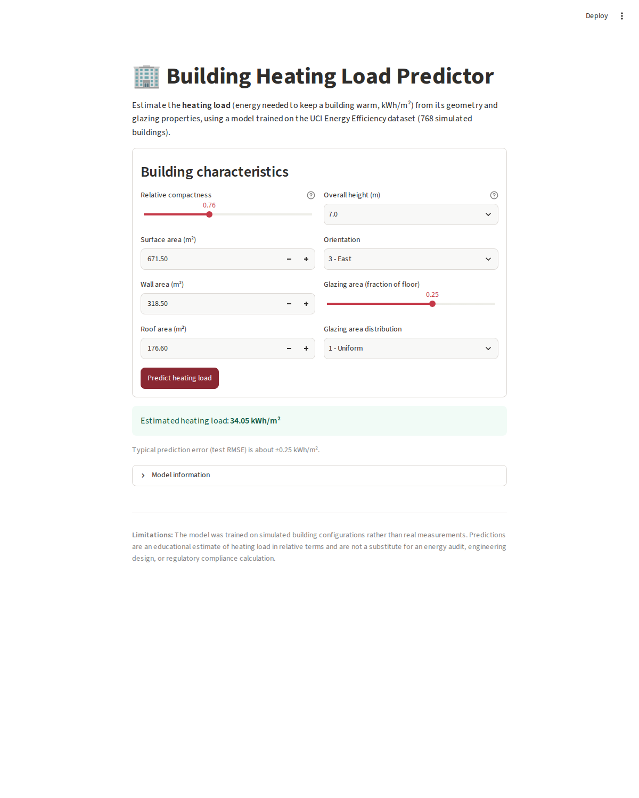

# Building Heating Load Predictor

A machine-learning mini project that predicts a building's **heating load**
(energy required to keep the interior warm, in kWh/m²) from its geometry and
glazing properties, and serves the prediction through a Streamlit app.

**Live app:** https://energy-efficiency-heating-load.streamlit.app/

## Problem statement

- **Prediction target:** heating load (`Y1`), a continuous, positive quantity, so the task is **regression**.
- **Input features:** 8 structural variables of a simulated building:
  relative compactness, surface area, wall area, roof area, overall height,
  orientation, glazing area, and glazing area distribution.
- **Who would use it:** architecture/energy students or early-stage building
  designers exploring how shape and glazing affect heating demand.
- **Limitation:** this is an **educational prototype** trained on *simulated*
  buildings. It is not an energy audit, not an engineering design tool, and not
  a substitute for professional or regulatory calculations.

## Dataset

- **Source:** UCI Machine Learning Repository: *Energy Efficiency* (ENB2012)
- **Link:** https://archive.ics.uci.edu/dataset/242/energy+efficiency
- **Citation:** Tsanas, A. & Xifara, A. (2012). *Accurate quantitative estimation of energy
  performance of residential buildings using statistical machine learning tools.*
  Energy and Buildings, 49, 560 to 567.
- **Size:** 768 records, 8 features, 2 targets (`Y1` heating load used, `Y2` cooling load excluded).

### Downloading the data

```bash
curl -sSL -o data/energy_efficiency.zip \
  "https://archive.ics.uci.edu/static/public/242/energy+efficiency.zip"
unzip -o data/energy_efficiency.zip ENB2012_data.xlsx -d data/
```
The file `data/ENB2012_data.xlsx` is already included in this repository.

## Project structure

```
ml-project/
├── data/
│   └── ENB2012_data.xlsx
├── notebooks/
│   └── analysis.ipynb      # EDA + model comparison (pre-executed with outputs)
├── models/
│   ├── heating_model.joblib
│   └── results.json        # metrics of every candidate model
├── train_model.py          # trains, tunes, evaluates, saves the pipeline
├── app.py                  # Streamlit application
├── requirements.txt        # runtime deps (used by the deployment)
├── requirements-dev.txt    # notebook + report tooling (local only)
└── README.md
```

## Method

1. **Split:** 80/20 train to test, `random_state=42`; the test set is only used once at the end.
2. **Preprocessing:** `StandardScaler` (helps KNN/SVR; harmless for trees) inside a `Pipeline`,
   so it is fitted on training folds only.
3. **Models compared:** Linear Regression, K-Nearest Neighbours, SVR, Random Forest.
4. **Cross-validation:** `KFold(5, shuffle=True)` on the training split.
5. **Hyperparameter tuning:** `GridSearchCV` per model, refit on R².
6. **Model choice:** the highest **cross-validated R²**, not a single lucky split.
7. **Saving:** the complete fitted pipeline is pickled with `joblib`; the app loads it
   and never retrains.

### Results (training split: 614 rows, test split: 154 rows)

| Model | CV R² | CV RMSE | Selected hyperparameters |
|---|---|---|---|
| Linear Regression | 0.9146 | 2.916 | n/a |
| K-Nearest Neighbours | 0.9436 | 2.373 | `n_neighbors=5` |
| SVR (RBF) | 0.9968 | 0.566 | `C=1000, gamma=0.1` |
| **Random Forest** | **0.9974** | **0.512** | `n_estimators=100, max_depth=None, min_samples_leaf=1` |

**Final held-out test performance (Random Forest): R² = 0.9977, RMSE = 0.493, MAE = 0.354.**

Why Random Forest: it matches SVR's accuracy while being the best model on
cross-validation, and unlike SVR it needs no feature scaling to perform well
and is less sensitive to the choice of hyperparameters. Linear regression's
weaker score confirms the relationships are non-linear.

## Running locally

```bash
python -m venv .venv
source .venv/bin/activate
pip install -r requirements.txt          # runtime only
# or, to also run the notebook and rebuild the report:
pip install -r requirements-dev.txt

python train_model.py     # optional: retrain (≈25 s)
streamlit run app.py
```

### Screenshot



## Deployment

The deployed app must load `models/heating_model.joblib` and must not retrain.
The model path is resolved relative to `app.py`, so the repository can be
deployed as-is on **Streamlit Community Cloud**, with:

- **Main file path:** `app.py`
- **Python version:** 3.12
- **Dependencies:** `requirements.txt` (pinned to the versions the model was trained with)

**Deployed link:** https://energy-efficiency-heating-load.streamlit.app/

## Documentation

- EDA and full model comparison: `notebooks/analysis.ipynb`
- Per-model metrics (machine readable): `models/results.json`

## Team contribution statement

| Member | Contribution |
|---|---|
| Vicky Nachna (253301049) | Problem definition, dataset understanding, EDA and preprocessing; model implementation, comparison and evaluation |
| Sachdev Parihar (253301039) | Pipeline, cross-validation and hyperparameter tuning; Streamlit interface, Git/GitHub organisation and deployment |

Both members understand and can explain the complete project.
