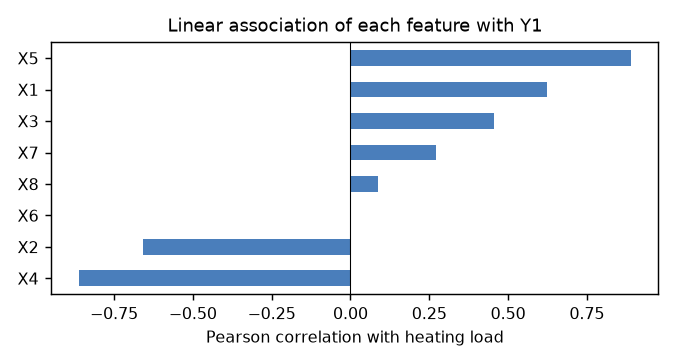
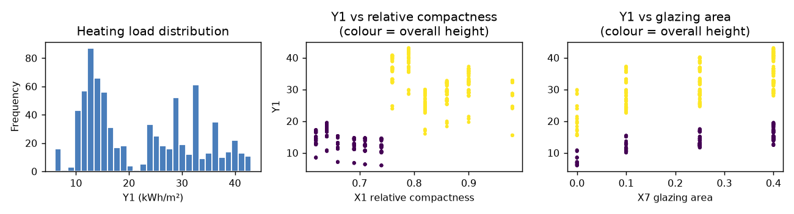
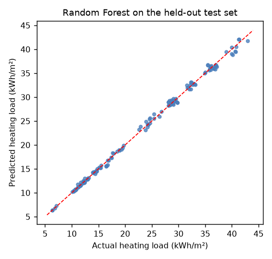
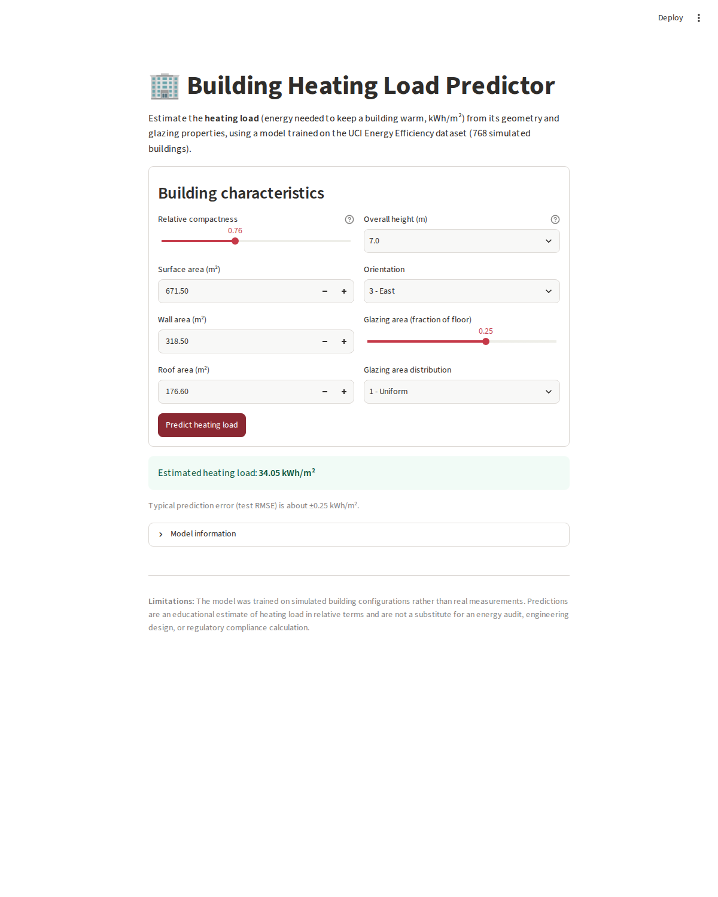

# 1. Title Page

**Predicting Building Heating Load: An End-to-End Machine Learning Mini Project**

Energy Efficiency Dataset (UCI ENB2012)

Team members: Vicky Nachna (253301049) and Sachdev Parihar (253301039), a two-member team, as permitted.

Course: Machine Learning Mini Project · Submission date: November 2026

# 2. Team Details

| Member | Roll No. | Primary Responsibility |
|---|---|---|
| Vicky Nachna | 253301049 | Problem definition, dataset understanding, EDA and initial preprocessing; model implementation, comparison and evaluation |
| Sachdev Parihar | 253301039 | Pipeline, cross-validation and hyperparameter tuning; Streamlit interface, Git/GitHub organisation and deployment |

For a team of two, the four responsibility areas suggested in the project manual
are combined into two roles. Responsibilities are divided for delivery, but both
members understand and can explain the complete workflow, including the parts
the other member implemented. See Section 18 for the individual contribution statement.

# 3. Abstract

This project predicts the **heating load** of a residential building, that is,
the energy required to maintain a comfortable indoor temperature, from its
structural geometry and glazing properties. Using the UCI Energy Efficiency
dataset (768 simulated buildings, 8 numeric features), four regression
algorithms were compared inside reproducible scikit-learn `Pipeline` objects,
selected using 5-fold cross-validation on a training split, and tuned with
`GridSearchCV`. A **Random Forest regressor** achieved the highest
cross-validated R² (0.9974) and, on a held-out test set it never saw during
development, produced **R² = 0.9977, RMSE = 0.493 kWh/m² and MAE = 0.354 kWh/m²**.
The complete fitted pipeline was serialised with `joblib` and served through a
Streamlit application that validates user input, loads the saved pipeline
without retraining, and returns a plain-language estimate together with a
statement of the model's limits. The repository contains the dataset, the
training script, the executed analysis notebook, the saved model, the app and
deployment instructions.

# 4. Problem Statement and Objectives

## 4.1 Prediction problem

Buildings account for a large share of energy use, and heating demand is
strongly affected by decisions made early in design: shape, height, and the
amount and placement of glazing. A designer who could estimate heating load from
these cheap-to-know properties alone would be able to screen alternatives long
before a full simulation is available.

- **Prediction target:** heating load (`Y1`), a continuous, positive quantity in kWh/m².
- **Task type:** **regression** (the target is real-valued and ordered; no class labels exist).
- **Main input features:** relative compactness, surface area, wall area, roof
  area, overall height, orientation, glazing area, and glazing area distribution.
- **Intended users:** architecture and energy-engineering students, and
  designers doing early-stage massing studies.
- **What the output means:** an estimate of the heating energy demand per unit
  floor area for a building with the given characteristics. Lower is better.
- **Limitation:** this is an **academic prototype** trained on simulated rather
  than measured buildings. It is not an energy audit, not a substitute for a
  building-physics simulation, and not a basis for professional, financial or
  regulatory decisions.

## 4.2 Objectives

1. Understand the dataset and its variables before modelling.
2. Build a preprocessing pipeline that behaves identically in training and deployment.
3. Compare at least three suitable regression algorithms using cross-validation.
4. Tune the selected model's hyperparameters with a documented search.
5. Evaluate exactly once on an untouched test set.
6. Save the complete fitted pipeline and serve it through a usable application.
7. Version-control the work and deploy it publicly and responsibly.

# 5. Dataset Description and Source

| Item | Details |
|---|---|
| **Name** | Energy Efficiency (ENB2012) |
| **Source** | UCI Machine Learning Repository |
| **Access link** | https://archive.ics.uci.edu/dataset/242/energy+efficiency |
| **Citation** | Tsanas, A. & Xifara, A. (2012). *Accurate quantitative estimation of energy performance of residential buildings using statistical machine learning tools.* Energy and Buildings, 49, 560 to 567. |
| **Records** | 768 buildings |
| **Inputs** | 8 numeric features |
| **Targets** | `Y1` heating load, `Y2` cooling load (only `Y1` is modelled) |
| **Missing data** | None |
| **Duplicates** | None |

The dataset was produced by simulating 768 building configurations in the
software Ecotect. Every feature takes values from a small documented grid, so
the data is fully balanced and complete, a deliberate choice by the original
authors to allow systematic comparison.

| Code | Feature | Unit / range | Type |
|---|---|---|---|
| X1 | Relative compactness | 0.62 to 0.98 | continuous |
| X2 | Surface area | 514.5 to 808.5 m² | continuous |
| X3 | Wall area | 245 to 416.5 m² | continuous |
| X4 | Roof area | 110.25 to 220.5 m² | continuous |
| X5 | Overall height | 3.5 or 7.0 m | binary (storeys) |
| X6 | Orientation | 2=N, 3=E, 4=S, 5=W | circular categorical code |
| X7 | Glazing area | 0, 0.10, 0.25, 0.40 | ordinal |
| X8 | Glazing area distribution | 0 (none) to 5 | nominal code |
| Y1 | **Heating load** | 6.01 to 43.10 kWh/m² | continuous target |

`X6`, `X7` and `X8` are stored as numbers but are semantically categorical/ordinal;
they are documented so that no reader mistakes them for continuous measurements.

# 6. Data Understanding and EDA

EDA was performed to support modelling decisions, not to decorate the report.
The full executed analysis is in `notebooks/analysis.ipynb`; key findings follow.

**Completeness and duplicates.** 768 rows, zero missing values, zero duplicate
records. No imputation or de-duplication is needed.

**Distribution of the target.** Heating load ranges 6.01 to 43.10 kWh/m² with a
mean of 22.31. The histogram is clearly **bimodal**, with modes near 12 and 32
(Figure 2, left). The split corresponds roughly to single- versus
double-storey buildings, which have very different compactness.

**Linear association with the target.** Overall height (`X5`, r = 0.889) and
roof area (`X4`, r = -0.862) show the strongest linear relationships, followed by
surface area (-0.658), relative compactness (0.622) and wall area (0.456).
Orientation (`X6`, r = 0.00) shows essentially **no linear association** with
heating load (Figure 1).





**What the relationship plots show.** In Figure 2 (middle and right), points
form clearly separated horizontal bands, one band per overall height, and the
relation between compactness/glazing and heating load is **non-linear and
interacting**. This is a direct modelling signal: a single straight line will
underfit, so tree ensembles or kernel methods are expected to win.

**Leakage check.** Heating load and cooling load correlate at r = 0.976. Y2 is
therefore **excluded from the feature set**; including it would leak the answer.

**Decisions supported by EDA.**

- No imputation; no dropping of rows.
- Keep `X6` to `X8` as numeric codes; the models used handle them adequately because
  the levels are few and the relationships are non-monotone (trees) or the
  distances remain meaningful under scaling.
- Use non-linear candidates (Random Forest, SVR) alongside a linear baseline,
  because the relationships are clearly non-linear.

# 7. Data Preprocessing

Preprocessing was kept minimal because the dataset is clean, and, critically,
it was placed **inside** a `Pipeline` so that exactly the same transformation is
applied at training, validation, testing and prediction time.

- **Missing values:** none present, so no imputation was fitted.
- **Identifiers / irrelevant fields:** `Y2` is dropped to prevent target leakage.
  There are no IDs.
- **Categorical variables:** `X6`, `X7` and `X8` are already integer codes with
  small cardinality and were retained as numeric. Tree models split them
  correctly; distance- and kernel-based models receive them after scaling.
- **Scaling:** `StandardScaler` is applied for KNN and SVR, where feature
  magnitude would otherwise dominate the distance/proximity calculation.
  It is retained in the pipeline for the Random Forest as well, which is
  harmless (trees are invariant to monotone feature scaling) and keeps one
  consistent object for every candidate.
- **No fitting on test data:** the scaler is fitted only on training folds by
  `GridSearchCV`/`cross_validate`, so validation and test information never
  influences the preprocessing parameters.

```python
Pipeline([("scaler", StandardScaler()), ("model", <estimator>)])
```

# 8. Algorithms Used

Four regression algorithms were implemented and compared. All are appropriate
for a small, tabular, continuous-target dataset.

| Algorithm | Why it was included |
|---|---|
| **Linear Regression** | Necessary baseline. Also tests whether the linear correlations in EDA are sufficient. |
| **K-Nearest Neighbours** | Non-parametric local model; sensitive to scaling, which exercises the pipeline. |
| **Support Vector Regression (RBF)** | Strong for small datasets with smooth non-linear structure; few but impactful hyperparameters. |
| **Random Forest Regressor** | Ensemble of trees; captures interactions and thresholds; robust to scale and outliers. |

# 9. Model Evaluation and Comparison

## 9.1 Metrics

- **R²**: proportion of variance in heating load explained; the primary selection metric.
- **RMSE**: root mean squared error in kWh/m², which penalises larger errors more heavily.
- **MAE**: mean absolute error in kWh/m², interpretable as a typical miss.

A model was **not** chosen because of a single lucky number. Selection used the
**mean cross-validated R² across five folds on the training split**, which
measures generalisation rather than fit to one split.

## 9.2 Data split

768 records were split 80/20 (`random_state=42`, `shuffle=True`, via
`train_test_split`): **614 training rows** and **154 test rows**. The test split
was set aside and used exactly once, after all selection and tuning were finished.

## 9.3 Cross-validated comparison (training split only)

`KFold(n_splits=5, shuffle=True, random_state=42)` was used for every model, with
hyperparameters tuned inside `GridSearchCV` (scoring on R², refitted on the best R²).

| Model | CV R² | CV RMSE (kWh/m²) | Best hyperparameters |
|---|---|---|---|
| Linear Regression | 0.9146 | 2.916 | n/a |
| K-Nearest Neighbours | 0.9436 | 2.373 | `n_neighbors=5` |
| Support Vector Regression (RBF) | 0.9968 | 0.566 | `C=1000, gamma=0.1, kernel='rbf'` |
| **Random Forest** | **0.9974** | **0.512** | `n_estimators=100, max_depth=None, min_samples_leaf=1` |

## 9.4 Interpretation and model choice

- Linear Regression explains 91.5% of variance but leaves an RMSE near 2.9 kWh/m².
  The gap between it and the non-linear models (±0.25 kWh/m²) confirms the
  **non-linearity visible in EDA**: glazing and compactness effects are
  not linear across heights.
- KNN improves on linear regression but plateaus, because the feature space is
  dominated by a few discrete levels and local averaging cannot separate
  neighbouring bands perfectly.
- SVR and Random Forest are statistically close. SVR is slightly behind on both
  CV metrics.
- **Random Forest was selected** because it had the best cross-validated R² *and*
  RMSE, it requires no scaling to perform well, it is far less sensitive to
  hyperparameter choice than an RBF-SVR (whose score depends heavily on the
  `C`/`gamma` grid), and it offers interpretable feature importances that support
  the discussion in Section 15.

# 10. Cross-Validation and Hyperparameter Tuning

## 10.1 What `cv=5` means

The 614 training rows are divided into five folds. The model is trained five
times; each time four folds are used for fitting and the remaining fold is used
for validation. Every row is used for validation exactly once. Averaging the
five scores gives a more reliable estimate than any single train/validation
split, and the spread across folds reports stability.

## 10.2 What `GridSearchCV` did

For each model, `GridSearchCV` evaluated the cross product of a specified
hyperparameter grid, ran 5-fold cross-validation for every combination, and
retained the combination with the best mean R². The best estimator was refitted
on the full training split. Grids searched:

| Model | Grid searched | Selected |
|---|---|---|
| KNN | `n_neighbors` in {3, 5, 7, 9, 11, 15} | **5** |
| SVR | `C` in {1, 10, 100, 1000}; `gamma` in {scale, 0.01, 0.1} | **C = 1000, gamma = 0.1** |
| Random Forest | `n_estimators` in {100, 200}; `max_depth` in {None, 10, 20}; `min_samples_leaf` in {1, 2, 4} | **n_estimators = 100, max_depth = None, min_samples_leaf = 1** |

The selected Random Forest settings are the most flexible in the grid
(unlimited depth, single-sample leaves) and yet were not overfitting: CV and
test scores agree closely (0.9974 vs 0.9977), and deeper forests add little
because the underlying function is smooth and low-noise.

# 11. Final Pipeline / Model

## 11.1 The pipeline

The deployable object is a `TransformedTargetRegressor` wrapping the fitted
pipeline:

```text
TransformedTargetRegressor
  +-- Pipeline
        +-- StandardScaler
        +-- RandomForestRegressor(n_estimators=100, max_depth=None,
                                  min_samples_leaf=1, random_state=42)
```

Using one object means the same scaling and same feature order are applied during
prediction as during training. The application cannot accidentally pass raw
features into a model trained on scaled ones.

## 11.2 Final, one-time test evaluation

| Metric | Value |
|---|---|
| **R²** | **0.9977** |
| **RMSE** | **0.493 kWh/m²** |
| **MAE** | **0.354 kWh/m²** |

The test results (Figure 3) are almost identical to the cross-validated
estimates, which is the expected signature of a model that generalises rather
than memorises. The typical error of about 0.35 to 0.49 kWh/m² is small relative
to the 37 kWh/m² range of the target.



## 11.3 Saving the model with Pickle

The **complete fitted pipeline**, not just the estimator, is serialised with
`joblib.dump` to `models/heating_model.joblib`. The deployed app loads that file
with `joblib.load` inside a cached function and calls `predict()` on it.
Training and tuning are **not** repeated at prediction time: this is why a
prediction takes milliseconds instead of the ~25 seconds of a full training run.

# 12. Streamlit Application

`app.py` provides a single-page interface.

- **Title and description** state what is predicted and on which data.
- **Input controls** mirror the dataset's actual value ranges:
  - sliders for relative compactness (0.62 to 0.98) and glazing area (0 to 0.40);
  - numeric inputs for surface, wall and roof area;
  - a selectbox for overall height (3.5 m or 7.0 m);
  - selectboxes with **human-readable labels** for orientation (North/East/South/West)
    and glazing distribution (Uniform, N/S, E/W, …), mapped to the numeric codes
    the model expects.
- **Input validation:** widgets constrain values to valid ranges, and the app
  refuses to start prediction if the model file is missing.
- **Model loading:** `@st.cache_resource` loads the joblib pipeline once per session.
- **Prediction:** a DataFrame is assembled in the **exact feature order** used in
  training.
- **Meaningful output:** the result is shown as text, e.g.
  *“Estimated heating load: 34.05 kWh/m²”*, not a bare number, alongside the
  typical error.
- **Transparency:** an expander shows the selected model, test metrics and the
  full comparison table so the user can see how the model was chosen.
- **Limitations:** a visible statement that the model is trained on simulated
  buildings, is educational in intent, and is not an energy audit or design
  authority.



# 13. Git and GitHub and Deployment

## 13.1 Version control

The project is maintained in Git with incremental, descriptive commits
(dataset -> training script -> app -> documentation) so that history shows the
development rather than a single upload. `.gitignore` excludes the virtual
environment and caches. `README.md` and `requirements.txt` are included, and each
member commits under their own account so contributions are visible.

## 13.2 Deployment

The deployed application must be reachable outside the local machine, must load
the saved pipeline, accept new input, and return a prediction **without running
GridSearchCV**. Steps taken:

1. Tested the complete project locally (`train_model.py` then `streamlit run app.py`).
2. Confirmed `app.py` and `models/heating_model.joblib` work together; the model
   path is resolved relative to `app.py`, so no absolute paths break on a server.
3. Created `requirements.txt` with pinned versions matching the versions used in
   training, and kept notebook and report tooling in a separate
   `requirements-dev.txt` so the deployment build installs only what the app needs.
4. Pushed to GitHub.
5. Deployed on Streamlit Community Cloud using `app.py` as the entry file.
6. Opened the deployed link in a separate browser session and tested several
   valid inputs. With the default inputs the app returned 34.05 kWh/m²; raising
   the glazing area from 0.25 to 0.40 returned 37.24 kWh/m², confirming that the
   deployed app reads live inputs and serves the same pipeline as the local one.

**Deployed link:** https://energy-efficiency-heating-load.streamlit.app/

# 14. Results and Screenshots

| Stage | R² | RMSE (kWh/m²) | MAE (kWh/m²) |
|---|---|---|---|
| Linear Regression (CV) | 0.9146 | 2.916 | n/a |
| KNN (CV) | 0.9436 | 2.373 | n/a |
| SVR (CV) | 0.9968 | 0.566 | n/a |
| Random Forest (CV) | 0.9974 | 0.512 | n/a |
| **Random Forest (final test)** | **0.9977** | **0.493** | **0.354** |

Figures: correlation analysis (Figure 1), target and relationship plots
(Figure 2), predicted-versus-actual on the test set (Figure 3), and the running
application (`screenshots/app.png`).

# 15. Limitations

1. **Simulated data.** The dataset comes from simulation, not measured
   buildings. Real buildings have thermal bridging, occupancy behaviour, weather
   and HVAC detail that this model cannot represent.
2. **Narrow design space.** Features take values from a small fixed grid, so
   predictions for unusual designs (e.g. glazing above 0.4, heights other than
   3.5/7.0 m) are extrapolation and should not be trusted.
3. **One target.** Cooling load is excluded by design; a real energy assessment
   needs both, plus total primary energy.
4. **High accuracy is partly structural.** R² of about 0.998 is impressive but the
   target is a deterministic function of the inputs in a low-noise simulation.
   This is not evidence of comparable accuracy on field data.
5. **No uncertainty estimate.** The app reports a typical error band, not a
   per-prediction confidence interval.
6. **Not a decision instrument.** The output must not be used for compliance,
   costing or professional advice.

# 16. Conclusion and Future Scope

The project delivered a complete, reproducible regression workflow: a documented
dataset, purposeful EDA, a preprocessing pipeline fitted only on training folds,
a fair comparison of four algorithms under 5-fold cross-validation, documented
hyperparameter tuning, a single held-out test evaluation, a saved end-to-end
model, a validated Streamlit interface, version control, and a deployment path.
The Random Forest model explains 99.77% of variance in heating load on unseen
data with a typical error under 0.5 kWh/m², and the analysis shows that
non-linear modelling is required to reach that level.

**Future scope.** Train a second model for cooling load and present both; add
prediction intervals (e.g. quantile forests); replace fixed-value widgets with
freer inputs and warn explicitly on extrapolation; add feature-importance and
partial-dependence views so designers can see which properties matter most; and
validate the approach on measured building energy data before any practical use.

# 17. References

1. Tsanas, A., & Xifara, A. (2012). *Accurate quantitative estimation of energy performance of residential buildings using statistical machine learning tools.* Energy and Buildings, 49, 560 to 567.
2. UCI Machine Learning Repository. *Energy Efficiency* dataset. https://archive.ics.uci.edu/dataset/242/energy+efficiency
3. Pedregosa, F., et al. (2011). *Scikit-learn: Machine Learning in Python.* Journal of Machine Learning Research, 12, 2825 to 2830.
4. Breiman, L. (2001). *Random Forests.* Machine Learning, 45(1), 5 to 32.
5. Drucker, H., Burges, C. J. C., Kaufman, L., Smola, A., & Vapnik, V. (1997). *Support Vector Regression Machines.* Advances in Neural Information Processing Systems 9.
6. Streamlit documentation. https://docs.streamlit.io

# 18. Individual Contribution Statement

| Member | Work performed |
|---|---|
| **Vicky Nachna** (253301049) | Defined the prediction problem and objectives; studied the dataset documentation; performed EDA (missing values, duplicates, distributions, correlations, leakage check) and set the preprocessing plan; implemented the four candidate regressors; built the comparison harness; interpreted the metrics and the model-selection argument in the report. |
| **Sachdev Parihar** (253301039) | Constructed the `Pipeline`; implemented 5-fold cross-validation and the `GridSearchCV` grids; performed the final test evaluation and the pickle serialisation; built the Streamlit interface; set up the Git repository and commit history; wrote the deployment steps, captured screenshots and maintained the README. |

_Both members work on the same repository and reviewed the complete codebase; each
can explain and modify every stage of the workflow, including the parts primarily
implemented by the other member._
